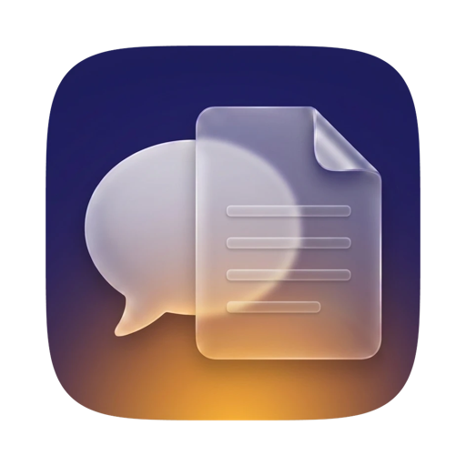

<h1 align="center">
   tacit
</h1>

<p align="center"><em>Never take notes again.</em></p>

<p align="center">
  <a href="https://github.com/sangmin7648/tacit/releases"></a>
  <a href="LICENSE"></a>
  <a href="https://github.com/sangmin7648/tacit/releases/latest"></a>
</p>

tacit is a macOS menu-bar app that listens as you talk and turns it into notes your AI can search.

<p align="center">
  
  <br>
  <sub>Illustration of the flow; not a screen recording.</sub>
</p>

## Install

```bash
curl -fsSL https://raw.githubusercontent.com/sangmin7648/tacit/main/install.sh | sh
open ~/Applications/Tacit.app
```

The first launch walks you through choosing your language, a speech model, and how notes are organized, and asks for microphone access. After that, tacit sits in your menu bar and starts listening.

Install with the command above rather than a browser download: Tacit.app isn't notarized. To update, choose **Check for Updates** from the menu-bar icon, or run the command again. macOS asks for microphone access again after an update.

## How it works

- **Just talk.** The menu-bar icon shows whether tacit is listening and when it hears speech. There is nothing to press.
- **Notes build up on their own.** Everything you say becomes a note with a title, keywords, and a short summary. Browse them by day and search them from the menu-bar icon.
- **Your AI can use them.** Ask Claude Code about something you said last week and it finds the note.

## Use with Claude

tacit adds two commands to [Claude Code](https://docs.anthropic.com/en/docs/claude-code):

```
/tacit.knowledge summarize the search ranking discussion from earlier
/tacit.knowledge find the API design we talked about last week
/tacit.knowledge any ideas about the onboarding flow from last month?

/tacit.memorize                       # save the current conversation as a note
/tacit.memorize skill development     # optional hint for how to file it
```

Notes saved with `/tacit.memorize` are found by `/tacit.knowledge` like anything you said aloud.

## Privacy

- Speech is transcribed on your Mac. Audio never leaves it.
- To organize notes, tacit sends the transcribed **text** to the model you choose: Ollama runs locally and sends nothing anywhere, while Claude receives the text.
- Notes are plain Markdown files under `~/.tacit/`. Read, edit, move, or delete them with any tool.

## Settings

Open **Settings** from the menu-bar icon. The ones most people change:

- **Language**: pin it to the language you speak. It makes transcription noticeably more accurate than auto-detect.
- **Speech model**: larger is more accurate but slower.
- **Note organizer**: Ollama (local) or Claude.
- **Vocabulary hint**: names and jargon that get misheard.

## Requirements

- macOS 13 or later, Apple Silicon
- [Ollama](https://ollama.com) or the [Claude Code CLI](https://docs.anthropic.com/en/docs/claude-code) to organize notes
- The Claude Code CLI to use `/tacit.knowledge` and `/tacit.memorize` (the only agent supported today)

## Contributing

Issues and pull requests are welcome. Open an issue first for significant changes. See [CONTRIBUTING.md](CONTRIBUTING.md) to build from source, and [docs/](docs/index.md) for how the system fits together.

## AI Disclosure

> [!NOTE]
> 🤖 **tacit is built with the help of AI coding agents.**
> I take code quality and stability seriously, and I do my best to review, test, and maintain it carefully. If you find a bug or something that looks off, please [open an issue](https://github.com/sangmin7648/tacit/issues).

## License

[MIT](LICENSE)
